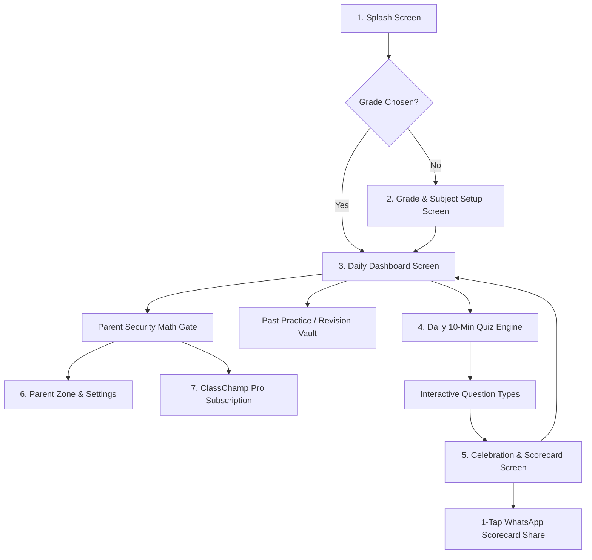

# ClassChamp — Product Blueprint & Technical Architecture
*Tagline: Daily 10-Min School Practice for CBSE & NCERT Kids*

---

## 1. Executive Summary & Vision

**ClassChamp** is an interactive, gamified micro-learning mobile application designed for primary school students (Classes 1 to 6, with an initial launch focus on Classes 3, 4, and 5 for Mathematics and English Grammar).

The app transforms routine homework drill into a delightful, 10-minute daily habit. By eliminating ad interruptions, adhering strictly to the **Google Play Families Policy**, and incorporating game mechanics (streaks, stars, badges, celebratory sounds), ClassChamp ensures high engagement for children while providing effortless 1-tap WhatsApp progress summaries for parents.

### Tech Stack Recommendation: React Native with Expo (TypeScript)
For a founder with zero coding experience, **React Native + Expo** is the optimal choice:
- **Instant Testing via Expo Go**: Test on your actual iPhone or Android device immediately by scanning a QR code—no need to install complex tools like Android Studio or Xcode in the early stages.
- **Single Cross-Platform Codebase**: One unified codebase runs seamlessly on both Android and iOS.
- **Reliable Offline-First Architecture**: Lightweight local storage (`AsyncStorage` + `Zustand`) ensures kids can practice anytime, anywhere, even with spotty internet connectivity.
- **Native-Grade Smooth Animations**: Powered by `react-native-reanimated` for joyful, stutter-free 60fps micro-interactions and celebration effects.
- **Kid-Safe Compliance**: Zero invasive third-party ad SDKs or trackers, fulfilling Google Play Families and COPPA requirements out of the box.

---

## 2. Product Architecture & Screen Hierarchy



### Detailed Screen Breakdown

#### 1. Splash Screen (`/splash`)
- **Visuals**: Animated ClassChamp logo with a cheerful bouncing pencil/trophy mascot.
- **Logic**: Checks local storage for saved user profile (Grade, Name, Streak count, Daily quiz completion status for today's calendar date).
- **Transitions**: Smoothly redirects to Grade Selection (first launch) or directly to the Daily Dashboard (< 1.5 seconds).

#### 2. Grade & Avatar Selection Screen (`/onboarding`)
- **Purpose**: Welcoming, friction-free onboarding.
- **Fields**: Child's First Name or Nickname, Grade Picker (Class 3, Class 4, Class 5), and choice of 6 fun kid-friendly animal avatars (Lion, Owl, Astronaut, Dolphin, Tiger, Falcon).
- **No Friction**: No phone numbers, emails, or passwords required upfront. Kids can start learning in under 15 seconds.

#### 3. Daily Dashboard (`/dashboard`)
- **Header**: Kid's Avatar, Name, Current Class badge, and the **Daily Fire Streak Counter** (e.g., "🔥 5-Day Streak!").
- **Daily Focus Card**: Prominently highlights today's 10-Minute Mission:
  - Subject 1: Maths (e.g., *Fractions & Shapes — 8 Questions*)
  - Subject 2: English (e.g., *Nouns & Adjectives — 8 Questions*)
- **Status Indicators**:
  - `Ready to Play` (Pulsing Play Button)
  - `Completed Today` (Golden Star Badge with Score: e.g., 90%)
- **Quick Stats Bar**: Total stars collected, trophies earned, weekly activity dots.
- **Bottom Navigation**: Home, Revision Vault, and Parent Zone (protected by Parent Gate).

#### 4. Core Quiz Engine (`/quiz`)
- **Header**: Live countdown timer (optional relaxed mode for kids), interactive animated progress bar (segment-based), and an exit button with confirmation.
- **Question Body**: Dynamic Question Renderer (MCQ, Fill in the blanks, Match the pairs, Drag & Drop).
- **Immediate Audio-Visual Feedback**:
  - Correct: Pleasant chime sound + soft green bounce animation + celebratory confetti burst.
  - Incorrect: Gentle "wobble" effect + friendly explanation hint (no punishing red buzzers).
- **Streak Multiplier**: Visual indicator showing consecutive correct answers ("Super Champ! 3 in a row!").

#### 5. Celebration & Scorecard Screen (`/celebration`)
- **Trophy & Stars Ceremony**: 1, 2, or 3 golden stars animated on screen based on percentage (60% = 1 star, 80% = 2 stars, 100% = 3 stars + trophy).
- **Performance Breakdown**:
  - Total Score (e.g., 8/10)
  - Time Taken (e.g., 06m 42s)
  - Accuracy & Concept Mastery (e.g., "Maths: 100% Geometry, 75% Fractions")
- **1-Tap WhatsApp Scorecard Generator**: Generates an attractive, beautifully rendered branded digital certificate image or formatted message that parents can share with family or school groups with one tap.
- **Action Buttons**: "Review Answers" and "Back to Dashboard".

#### 6. Parent Zone & Settings (`/parent-zone`)
- **Parent Security Gate**: Requires answering an adult math question (e.g., "Multiply 14 × 7 = ?") or biometric unlock to prevent children from accessing settings, external links, or purchases.
- **Features**:
  - Detailed performance analytics & chapter-wise weakness reports.
  - Grade switch option (allows siblings to switch grades).
  - Sound effects & voiceover toggle.
  - Manage Subscription / ClassChamp Pro status.
  - Safe Play Store feedback & privacy policy link.

#### 7. Freemium Paywall Modal (`/paywall`)
- **Model**:
  - Free Tier: 1 Daily Practice Quiz per subject every single day (forever free habit builder).
  - Pro Tier: Unlimited practice quizzes, past chapter revisions, detailed mastery reports, and personalized mistake-correction worksheets.
- **Pricing Display**: Affordable monthly & annual plans (e.g., ₹199/month or ₹1,499/year).
- **Mock / Sandbox Flow**: Realistic test purchase flow built for development and approval.

---

## 3. UI/UX & Design System

### Color Palette
Carefully crafted for maximum legibility, high contrast, and energetic, warm kid appeal:
- **Primary Brand**: Royal Blue (`#1E40AF` & `#2563EB`) — inspires trust, focus, and clarity.
- **Accent Brand**: Golden Champ Yellow (`#F59E0B` & `#FBBF24`) — symbolizes stars, trophies, and celebration.
- **Success / Correct**: Bright Emerald Green (`#10B981`) — positive reinforcement.
- **Soft Warning / Review**: Soft Coral Orange (`#F97316`) — gentle, non-threatening mistake indicator.
- **Background Neutral**: Warm Soft Cream (`#F8FAFC` to `#F1F5F9`) — reduces eye strain compared to harsh stark white.
- **Card Surfaces**: Pure White (`#FFFFFF`) with soft, tactile drop shadows.
- **Dark Text**: Deep Charcoal Navy (`#0F172A`) for effortless readability.

### Typography
- **Headings & Badges**: Bold, rounded typography (e.g., `Fredoka`, `Nunito`, or system-rounded fonts) for playful warmth.
- **Body & Questions**: Highly legible sans-serif with generous letter spacing and line heights suitable for 8-11 year old readers.

### Micro-Animations & Audio Design
- **Tactile Button Press**: Scale down to 96% on press with spring-back animation (`react-native-reanimated`).
- **Sound Effects (SFX)**:
  - Button tap: Gentle pop (`pop.mp3`).
  - Correct answer: Upbeat harmonic chime (`ding_correct.mp3`).
  - Incorrect answer: Soft muted thump (`gentle_thud.mp3`).
  - Quiz complete: Grand celebratory fanfare with confetti (`fanfare.mp3`).
- **Haptic Feedback**: Subtle vibration on mobile for tactile engagement (via `expo-haptics`).

---

## 4. Interactive Question Bank Schema

All questions are structured using a clean, extensible JSON format. Each question defines its `type`, `curriculum`, `grade`, `subject`, `concept`, `difficulty`, and interactive payloads.

### JSON Schema Definition

```json
{
  "$schema": "http://json-schema.org/draft-07/schema#",
  "title": "ClassChampQuestion",
  "type": "object",
  "required": ["id", "grade", "subject", "chapter", "concept", "type", "question", "explanation", "points"],
  "properties": {
    "id": { "type": "string" },
    "grade": { "type": "integer", "enum": [3, 4, 5] },
    "subject": { "type": "string", "enum": ["maths", "english"] },
    "chapter": { "type": "string" },
    "concept": { "type": "string" },
    "difficulty": { "type": "string", "enum": ["easy", "medium", "hard"] },
    "type": { 
      "type": "string", 
      "enum": ["mcq", "fill_blank", "match_pairs", "drag_order"] 
    },
    "question": { "type": "string" },
    "visualAsset": { "type": "string", "description": "Optional illustration or emoji key" },
    "payload": { "type": "object" },
    "explanation": { "type": "string" },
    "points": { "type": "integer", "default": 10 }
  }
}
```

### Concrete Question Examples by Type

#### Type 1: Standard MCQ with Emoji / Visual Clues (Maths — Class 3)
```json
{
  "id": "m3_frac_001",
  "grade": 3,
  "subject": "maths",
  "chapter": "Fractions",
  "concept": "Halves and Quarters",
  "difficulty": "easy",
  "type": "mcq",
  "question": "A delicious pizza 🍕 is cut into 4 equal slices. Rohan eats 1 slice. What fraction of the pizza did Rohan eat?",
  "visualAsset": "pizza_quarter",
  "payload": {
    "options": [
      { "id": "opt_a", "text": "1 / 4", "isCorrect": true },
      { "id": "opt_b", "text": "1 / 2", "isCorrect": false },
      { "id": "opt_c", "text": "3 / 4", "isCorrect": false },
      { "id": "opt_d", "text": "2 / 4", "isCorrect": false }
    ]
  },
  "explanation": "Since the pizza has 4 equal parts and Rohan ate 1 part, the fraction is 1 out of 4, written as 1/4!",
  "points": 10
}
```

#### Type 2: Fill in the Blank with Word Bank (English Grammar — Class 4)
```json
{
  "id": "e4_prep_002",
  "grade": 4,
  "subject": "english",
  "chapter": "Prepositions",
  "concept": "Prepositions of Place",
  "difficulty": "medium",
  "type": "fill_blank",
  "question": "The mischievous kitten jumped ______ the kitchen table.",
  "visualAsset": "cat_jump",
  "payload": {
    "correctAnswer": "onto",
    "wordBank": ["onto", "under", "between", "inside"],
    "displayTemplate": "The mischievous kitten jumped [BLANK] the kitchen table."
  },
  "explanation": "We use 'onto' when showing movement towards a high surface like a table!",
  "points": 10
}
```

#### Type 3: Match the Pairs (Interactive Connection) (Maths — Class 5)
```json
{
  "id": "m5_geom_003",
  "grade": 5,
  "subject": "maths",
  "chapter": "Shapes and Angles",
  "concept": "Angle Classification",
  "difficulty": "medium",
  "type": "match_pairs",
  "question": "Match each angle measurement with its correct geometric name!",
  "payload": {
    "pairs": [
      { "id": "p1", "left": "90°", "right": "Right Angle" },
      { "id": "p2", "left": "45°", "right": "Acute Angle" },
      { "id": "p3", "left": "120°", "right": "Obtuse Angle" },
      { "id": "p4", "left": "180°", "right": "Straight Angle" }
    ]
  },
  "explanation": "Less than 90° is Acute, exactly 90° is Right, between 90° and 180° is Obtuse, and 180° is Straight.",
  "points": 15
}
```

#### Type 4: Drag & Drop Ordering / Sentence Unscramble (English — Class 3)
```json
{
  "id": "e3_sent_004",
  "grade": 3,
  "subject": "english",
  "chapter": "Sentence Building",
  "concept": "Word Order",
  "difficulty": "easy",
  "type": "drag_order",
  "question": "Arrange the words in the correct order to make a sensible sentence:",
  "payload": {
    "tokens": ["The", "sun", "rises", "in", "the", "east."],
    "scrambled": ["rises", "The", "east.", "in", "sun", "the"],
    "correctSequence": ["The", "sun", "rises", "in", "the", "east."]
  },
  "explanation": "A complete sentence starts with a capital letter and follows Subject + Verb + Object order.",
  "points": 15
}
```

---

## 5. WhatsApp Scorecard Generator Design

When a child finishes their daily practice, the app dynamically renders a high-resolution, kid-proud scorecard card.

### Format & Layout
```
+------------------------------------------------------+
|  🌟 CLASSCHAMP DAILY REPORT CARD 🌟                  |
|  Date: 15 Oct 2026 | Class: 4 | Streak: 🔥 7 Days    |
|                                                      |
|  Champion: Aarav Sharma                              |
|  Today's Focus: Mathematics & English Grammar        |
|                                                      |
|  ⭐ Score: 9 / 10 (90%) - EXCELLENT!                 |
|  ⏱️ Time Taken: 05 mins 12 secs                      |
|                                                      |
|  🎯 Mastery Highlights:                              |
|  ✅ Fractions: 100% Mastery                          |
|  ✅ Prepositions: 80% Mastery                        |
|                                                      |
|  🏆 Badges Earned Today: "Speedy Star" ⚡             |
|                                                      |
|  Parents: "Keep up the 10-min daily habit!"          |
|  Download ClassChamp App on Google Play              |
+------------------------------------------------------+
```

### WhatsApp Integration Strategy
1. **Direct One-Tap Sharing**: Uses `react-native-view-shot` to snapshot the scorecard view into a crisp PNG, combined with `expo-sharing` to launch WhatsApp directly with the child's image summary and a pre-written proud message.
2. **Text Fallback**: If image permissions are restricted, it instantly sends an emoji-rich text summary directly via WhatsApp URL scheme (`whatsapp://send?text=...`).

---

## 6. Google Play Families Policy & Kid-Safe Architecture

To guarantee approval under Google Play's strict **Designed for Families** and **Teacher Approved** standards:
1. **Zero Third-Party Ad Networks**: Absolutely no banner ads, interstitial video ads, or behavioral retargeting.
2. **COPPA Compliant Data Collection**: No persistent identifiers collected from children (no advertising ID, no GPS location, no contact list access).
3. **Parent Gate for Outbound Actions**: External links, WhatsApp sharing, settings, and subscription purchasing require passing an adult calculation challenge (e.g., two-digit multiplication or word puzzles).
4. **No Social Media SDKs**: Direct native sharing is handled exclusively through OS-level share intents without embedding tracking SDKs.

---

## 7. Step-by-Step Phased Implementation Roadmap

| Phase | Title | Core Deliverables | Verification Milestone |
|---|---|---|---|
| **Phase 1** | **Project Setup & Folder Architecture** | Initialize Expo TypeScript project, clean folder structure, core dependencies, vector icons, navigation router. | Blank app boots cleanly with header & logo on simulator / Expo Go. |
| **Phase 2** | **Design System & Reusable Components** | Typography tokens, Royal Blue & Gold theme, buttons, card wrappers, animated progress bar, mascot badges. | Interactive UI showcase demonstrating buttons, cards, and theme switching. |
| **Phase 3** | **Core Quiz Engine Foundation** | Quiz state manager (Zustand), countdown timer, sound system (`expo-av`), haptics, score accumulator. | Functional quiz loop transitioning from Q1 to Q10 with working sound and timer. |
| **Phase 4** | **Dynamic Question Renderers** | Custom components for MCQ, Fill-in-Blanks, Match-the-Pairs, and Drag/Drop Reordering. | All 4 question types rendered with interactive touch gestures and validation. |
| **Phase 5** | **Gamification & Offline Storage** | `AsyncStorage` streak manager, star counter, trophy room, daily completion lock, mock NCERT question bank. | Streak counter increments on completion and persists across app restarts. |
| **Phase 6** | **Celebration Screen & WhatsApp Scorecard** | Confetti explosion (`canvas-confetti` / reanimated), scorecard view snapshot (`view-shot`), 1-tap WhatsApp share. | Tap "Share to WhatsApp" generates image scorecard and opens share sheet. |
| **Phase 7** | **Parent Gate & Freemium Subscription** | Adult multiplication security modal, Parent dashboard, Chapter mastery analytics, Mock Pro paywall. | Child cannot bypass math challenge; parent can access analytics and upgrade flow. |
| **Phase 8** | **Production Polish & Play Store Readiness** | App icons (512x512), adaptive Android icons, splash screen, Families policy checklist, Android APK/AAB build scripts. | Production `.aab` ready for Google Play Console submission. |

---

## 8. Directory & Folder Structure (Target Architecture)

```
ClassChamp/
├── assets/
│   ├── audio/              # ding_correct.mp3, gentle_thud.mp3, fanfare.mp3, pop.mp3
│   ├── icons/              # App icon, adaptive icon, favicon
│   ├── images/             # Mascots, badges, pizza illustrations, trophies
│   └── splash/             # Splash screen graphic
├── src/
│   ├── components/         # Reusable design system components
│   │   ├── common/         # Button, Card, Header, Badge, ProgressBar
│   │   ├── quiz/           # QuestionRenderer, MCQCard, FillBlank, MatchPairs
│   │   └── scorecard/      # CertificateView, StarRating
│   ├── constants/          # Theme (Colors, Fonts, Spacing), Config
│   ├── data/               # Curated CBSE Question Banks (Class 3, 4, 5 Maths & English)
│   ├── hooks/              # useTimer, useQuizState, useAudioPlayer, useStreak
│   ├── navigation/         # App navigation container & stack definitions
│   ├── screens/            # Full-screen views (Splash, Onboarding, Dashboard, Quiz, Celebration, ParentZone)
│   ├── store/              # Zustand global state (userProfile, quizHistory, streakStore)
│   └── utils/              # SoundManager, WhatsAppShareHelper, ParentGateMath
├── app.json                # Expo configuration & Google Play Families metadata
├── package.json            # Project dependencies & run scripts
└── tsconfig.json           # Strict TypeScript configuration
```

---

*This blueprint serves as our single source of truth for the entire development lifecycle.*
